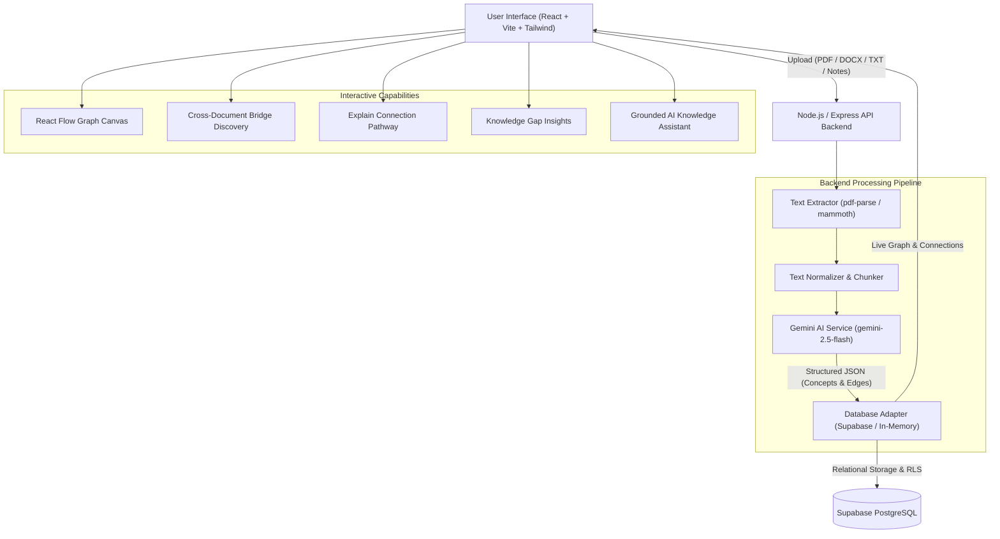

# 🌐 KnowledgeGraph AI — Production Full-Stack GenAI Application

> **Turn Unstructured Documents into Connected, Searchable, and Grounded Knowledge Networks.**

KnowledgeGraph AI is a modern SaaS platform designed to transform multi-format documents (PDF, DOCX, TXT, Notes) into interactive, topological knowledge networks. Using **Google Gemini** for structured ontological extraction and **React Flow** for canvas graph visualization, it discovers conceptual bridges across isolated documents, audits knowledge gaps, and provides an AI knowledge assistant with zero-hallucination source grounding.

---

## 🏗️ System Architecture



---

## ⚡ Tech Stack

- **Frontend:** React 18, Vite, Tailwind CSS, `@xyflow/react` (React Flow), Lucide React.
- **Backend:** Node.js, Express, `pdf-parse`, `mammoth`, `@google/genai` (Gemini REST API), Multer.
- **Database:** Supabase PostgreSQL with Row Level Security (RLS) policies & indexes.
- **AI Core:** Google Gemini 2.5 Flash / 2.0 Flash with structured JSON schema responses.

---

## 🚀 Quick Start (Running Locally)

### 1. Start Backend API
```bash
cd backend
npm install
npm run dev
```
*Backend runs on: `http://localhost:5000`*

### 2. Start Frontend App
```bash
cd frontend
npm install
npm run dev
```
*Frontend runs on: `http://localhost:5173`*

---

## 🔑 How to Get & Configure Free Keys

### 1. Google Gemini API Key (100% Free)
1. Go to [Google AI Studio](https://aistudio.google.com/app/apikey).
2. Click **"Get API Key"** $\rightarrow$ **"Create API Key in new project"**.
3. Copy your key (`AIzaSy...`) and paste it in `backend/.env` or inside the **Settings** page in the UI!

### 2. Supabase PostgreSQL (100% Free)
1. Go to [supabase.com](https://supabase.com) and create a free project.
2. In **Project Settings $\rightarrow$ API**, copy your **Project URL** and **anon public API key**.
3. In the **SQL Editor**, paste the entire contents of `supabase/schema.sql` and click **Run**.
4. Paste the URL and key in `backend/.env` or in the **Settings** page in the UI!

> 💡 **Instant Demo Fallback:** Even without keys entered, the application comes with built-in in-memory state and intelligent heuristic extractors so it runs immediately out of the box with zero crashes!

---

## 🎯 Practical Exam / Viva Cheatsheet (What to Say)

1. **Project Objective:**
   *"Sir, raw documents contain isolated data. KnowledgeGraph AI extracts atomic concepts and directional relationships using Google Gemini, synthesizing them into an interactive React Flow graph with cross-document discovery."*

2. **Cross-Document Bridges:**
   *"Unlike simple RAG search, our system connects concepts between different documents—for example, linking 'Model Evaluation' from an ML document to 'Software Testing' from a QA document."*

3. **Grounded AI Assistant:**
   *"The assistant does not hallucinate because it grounds its reasoning strictly in graph topological nodes and document chunks with explicit citations."*
